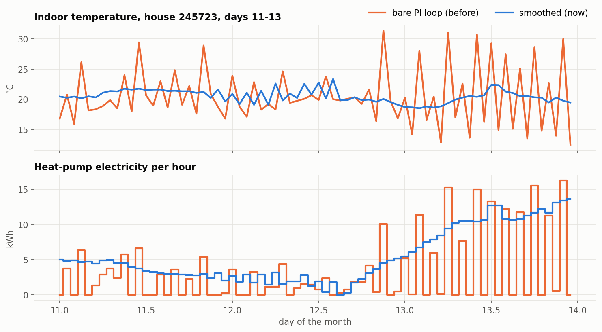
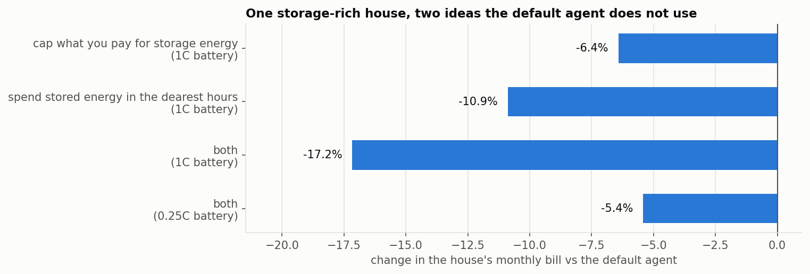

# 1. How strong is the default agent?

[← gallery](README.md)

The default agent runs every house nobody claims, and your score is your bill
against it on the same houses. So it is worth knowing what it does well, what
it does badly, and what it took to find out.

**What it does:** holds the middle of the comfort band with the shared
`Thermostat`; fills its battery from the grid in the cheapest hours before each
price peak (overnight for the morning, 12:00–15:00 for the evening) when peers
have not supplied enough; buys peers' solar for storage; spreads its stored
energy evenly over each peak window and sells what the house does not need at
$0.10/kWh; bids the full grid price for whatever it wants to buy; and lets its
battery absorb forecast error in real time (`net_target_kwh`).

---

## A fault in the thermostat, found and fixed

Every agent uses the shared `Thermostat` unless it writes its own. It used to
be a bare PI loop, acting once an hour on a heat pump that moves these houses
about 1 K per kWh. That combination oscillates: one hour full on and far too
warm, the next off and too cold, over and over. Consecutive hourly temperature
changes were strongly anti-correlated (−0.58), and in the worst house the
indoor temperature swung between 13 °C and 31 °C.

The fix is one line: each hour's command is blended half-and-half with the
previous hour's (`Thermostat(smoothing=0.5)`, now the default).

| full month, all 20 houses on the default agent | bare loop | smoothed |
|---|---:|---:|
| bill | $10,725 | **$9,846** |
| comfort penalty | $2,183 | **$259** |
| hours fully inside the band | 84.7% | **95.5%** |
| heat-pump electricity | 62,348 kWh | 70,087 kWh |
| hour-to-hour correlation of temperature change | −0.58 | +0.25 |

Holding the band costs more heating energy (+12%): the oscillating loop had
been saving energy by letting houses run cold. The damage was concentrated in a
handful of houses — one house alone paid $1,221 a month in comfort penalties —
while in calm houses the smoothed loop costs a few percent more. Running colder
on purpose is still possible through the thermostat's `aim`, as a priced
decision rather than a control fault.

**What did not work as well**, measured on days 8–31 against the bare loop:
halving the controller's gains removed most of the oscillation but left four
times the degree-hours of the blend (604 vs 141). Steering the heat pump
directly from a fitted one-hour thermal model was worse than doing nothing
(5,273 degree-hours vs 3,315): that model is good enough to plan with, not to
control with.

---

## Two ideas the default agent does not use

Both were tested on a single storage-rich house, all other houses on the
default agent, everything except the named idea unchanged.

1. **Cap what you pay for energy to store.** Bid the full grid price only for
   energy the house must draw anyway (its load after planned discharge, plus
   any planned grid top-up). Energy wanted for storage is bid at no more than
   $0.06/kWh — about what the midday grid top-up costs after battery losses.
   The default agent bids the grid price for storage energy too, and in the
   morning that means paying 14–20¢ for solar it could top up at 6¢.
2. **Spend stored energy in the dearest hours.** Instead of spreading the
   battery evenly over a peak window, weight each remaining hour of the window
   by its price squared (the 24-hour price shape is published), so 18:00 at
   $0.45 gets far more than 16:00 at $0.22. Still empty the battery by the end
   of the window — what the house does not need is sold to peers.

| one storage-rich house, full month | house bill | change | other 19 houses | all 20 |
|---|---:|---:|---:|---:|
| default agent, house 199613 (80 kWh, 80 kW) | $420.33 | | | |
| cap storage purchases | $393.33 | −6.4% | +$35 | +$8 |
| spend in the dearest hours | $374.56 | −10.9% | −$14 | −$60 |
| **both** | **$348.13** | **−17.2%** | +$22 | −$51 |
| default agent, house 147002 (80 kWh, 20 kW) | $839.12 | | | |
| both | $793.55 | −5.4% | −$4 | −$50 |

- **Spending in the dearest hours is a real efficiency gain**: the same stored
  kWh displaces dearer grid power, so the whole market is better off.
- **Capping purchases is mostly a transfer**: the house pays sellers less, and
  they lose what it saves.
- **The slow battery gains a third as much**: 20 kW cannot concentrate its
  energy into the two dearest hours.
- **A first version of idea 2 lost 11%.** It gave each peak hour only the
  house's own need, dearest first — so it never sold to peers and finished
  each evening with 40% of the battery unused. Read your own `settlements.csv`
  before trusting an idea.

## Try it yourself

- Rebuild idea 2 and check you get about −11% on house 199613. What exponent
  on the price works best — and why does the answer depend on the battery's
  C-rate?
- The thermostat now holds the band. Is that always worth its energy? Find an
  hour where letting the house drift is cheaper than heating it, and use `aim`
  to do it on purpose.
