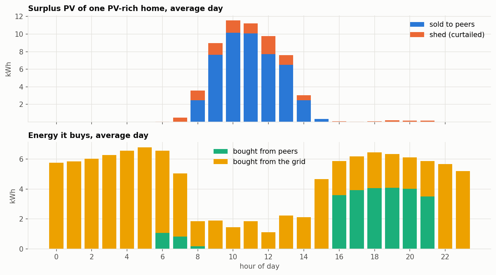
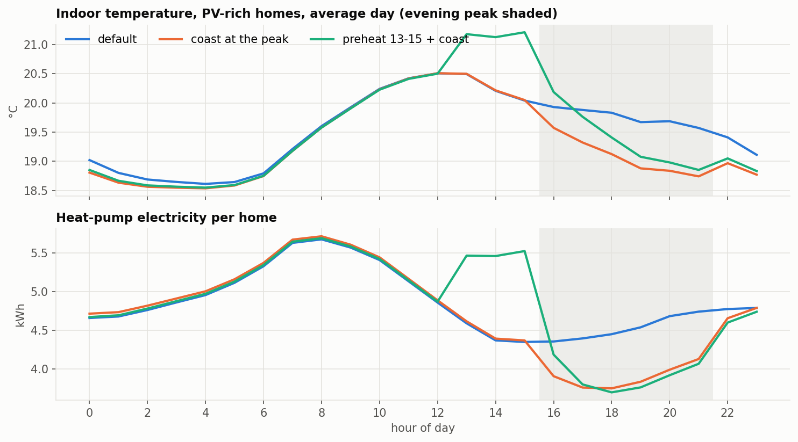

# 2. PV-rich homes and the building as a battery

[← gallery](README.md)

## Slaves to the market?

The ten PV-rich homes have 40 kW of PV and a 4 kWh / 1 kW battery. Their PV is
large, but heating is larger, and the two happen at different times of day.

| the ten PV-rich homes, default agent, full month | |
|---|---:|
| PV produced, per home per day | 93 kWh |
| consumption, per home per day (heat pump 116 kWh) | 149 kWh |
| PV used at home in the same hour | 47% of PV, covering 29% of consumption |
| **surplus** | **61% of all PV** (17,776 kWh) |
| — sold to peers | 83% of the surplus, at **7.0¢/kWh** on average |
| — shed (curtailed) | 17% of the surplus |
| **evening (16:00–21:00) purchases** | 7,191 kWh from peers at **21.7¢**, 4,229 kWh from the grid at **31.7¢** |
| earned on surplus vs spent in the evening | $1,021 vs $2,900 |

On 74% of house-days the day's surplus exceeds the evening's heat-pump use —
typically 52 kWh of surplus against 22 kWh of evening heating. The energy
exists. What is missing is somewhere to keep it: the battery holds 4 kWh.

## Can the building store it as heat?

A warmer house is a store of heat, and the PV-rich homes have spare energy at
midday. Three strategies were tested on all ten PV-rich homes at once, each
home its own participant, the storage-rich homes on the default agent:

- **coast:** during the evening peak (16:00–21:00, grid ≥ $0.20) aim halfway
  between the middle and the bottom of the comfort band; otherwise the middle.
- **late preheat + coast:** as coast, and aim near the top of the band
  (80% of the way from the middle to the top) from 13:00 to 15:00 — the last
  cheap hours, so as little heat as possible leaks away before the peak.
- **solar preheat + coast:** as coast, and aim near the top of the band in
  any hour from 08:00 to 16:00 when the house had its own PV surplus.

All use the default smoothed thermostat to reach their aim.

| ten PV-rich homes, full month | default | coast | late preheat + coast | solar preheat + coast |
|---|---:|---:|---:|---:|
| **bill** | $5,705 | **$5,436 (−4.7%)** | $5,513 (−3.4%) | $5,775 (+1.2%) |
| comfort penalty | $130 | $165 | $189 | $363 |
| heat pump 13:00–15:00 | 4,124 kWh | 4,145 | **5,099** | 5,125 |
| heat pump 16:00–21:00 | 8,416 kWh | **7,239** | 7,258 | 7,268 |
| evening purchases | $2,900 | $2,577 | $2,586 | $2,591 |
| indoor temperature at 15:00 / 18:00 | 20.0 / 19.8 °C | 20.0 / 19.1 | 21.2 / 19.4 | 21.4 / 19.6 |
| storage-rich homes' bill | $4,141 | $4,174 | $4,191 | $4,210 |

- **Preheating stores heat, but not for long.** It adds 954 kWh of heating in
  the afternoon and the houses are 1.2 K warmer at 15:00 — but only 0.3 K
  warmer at 18:00, and the evening heat-pump use is the same as coasting
  alone. The extra heat leaks away within about three hours.
- **Coasting is what saves money**: sitting lower in the band during the peak
  uses 14% less evening heat, at a modest comfort cost. It does not shift
  energy; it uses less of it.
- **Solar preheating loses**: it starts too early, overshoots the band, and the
  heat is gone long before evening.

**Why so leaky?** A simple heat-balance model fitted to these houses finds
about **1.6 kWh of heat per kelvin** of indoor temperature, and **about 29%** of
any temperature difference to outdoors lost every hour. A house raised 2 K
holds roughly 3 kWh of heat, and keeps a fifth of it after five hours. The
buildings are CityLearn's thermal models trained on ResStock data; real heavy
buildings may hold heat longer, and a hot-water tank — not modelled here —
would store far more.

**So the PV-rich homes cannot escape their evening dependence on their own.**
Their surplus has to be stored by someone else — the storage-rich homes — and
how the money is split between them is a question of market power: see
[page 3](03_market_power.md).

## Try it yourself

- Build "coast" and find the best `aim` for the peak: how low before the comfort
  penalty outweighs the saving?
- When would preheating pay? Try preheating only in the hour or two directly
  before the peak, and only on cold days, and measure the heat left at 18:00.
