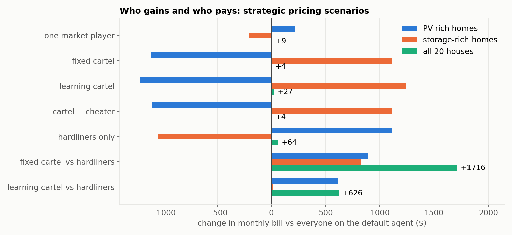
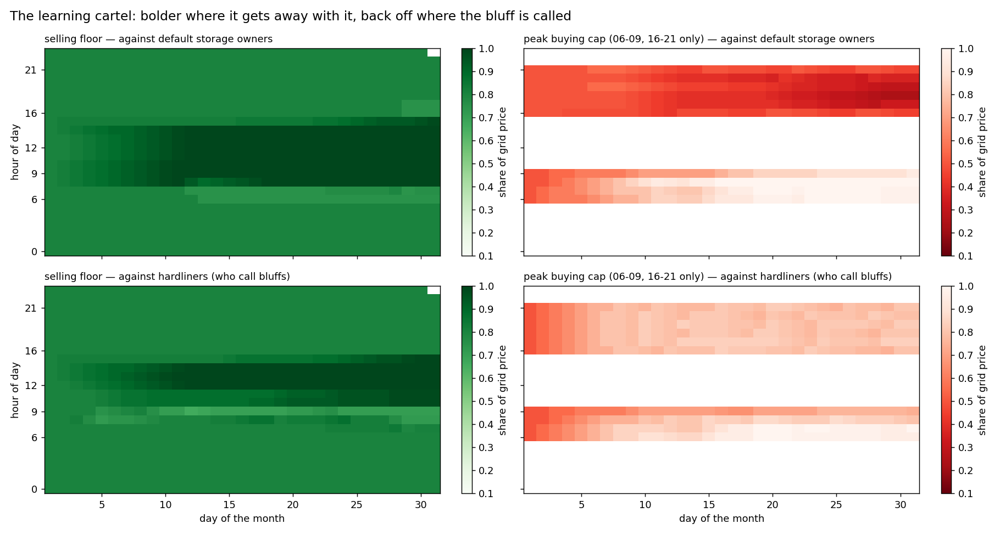

# 3. Market power: players, cartels and cheaters

[← gallery](README.md)

The market clears at **one price per hour**: of the prices that trade the most
energy, the one where demand and supply are closest — so excess demand pushes
it up that range, excess supply down. Everyone who trades in that hour gets
that price.
Two things follow, and every scenario below is an illustration of them:

- **A bid can move the price for everyone.** Raise your ask and, if it still
  clears, the price rises for every seller in that hour, not just for you.
- **Money moves much more easily than energy.** Most strategies below shift
  hundreds of dollars between groups while the energy traded, imported and
  curtailed barely changes.

The stock has ten **PV-rich** homes (big surplus at midday, buyers in the
evening) and ten **storage-rich** homes (80 kWh batteries, buyers at midday,
sellers in the evening). The default agent asks $0.01 off-peak and $0.10 at
peak for what it sells, and bids the full grid price for what it buys.

All numbers: full month, compared with every house on the default agent.

| scenario | PV-rich homes | storage-rich homes | all 20 houses |
|---|---:|---:|---:|
| everyone on the default agent | $5,705 | $4,141 | $9,846 |
| one market player | +$217 | −$208 | +$9 |
| fixed cartel | −$1,111 | +$1,115 | +$4 |
| learning cartel | −$1,212 | +$1,239 | +$27 |
| cartel with a cheater | −$1,103 | +$1,107 | +$4 |
| hardliners only | +$1,113 | −$1,049 | +$64 |
| fixed cartel vs hardliners | +$891 | +$825 | **+$1,716** |
| learning cartel vs hardliners | +$611 | +$15 | **+$626** |

---

## One market player

One storage-rich home (house 199613) keeps the default agent's physical plan —
same heating, same battery schedule — and changes only its prices: it buys
energy for storage only at **$0.02/kWh or less**, and in the peaks sells only
at **80% of the grid price or more**. (This is
[`agents/basic/market_player.py`](../../agents/basic/market_player.py).)

| | default | market player |
|---|---:|---:|
| the player's house | $420.33 | **$393.89 (−6.3%)** |
| clearing price in the hours it sold | 66% of grid | **90% of grid** |
| the other nine storage-rich homes | $3,721 | $3,539 (−$181) |
| the ten PV-rich homes | $5,705 | $5,923 (+$217) |

Its high asks still cleared, and lifted the peak price for every seller. The
other storage owners gained nearly seven times what the player did, without
changing anything; the PV-rich homes, buying at the peak, paid for it.
Interactive: [`../runs/market_player.html`](../runs/market_player.html).

## A cartel of the PV-rich homes

All ten PV-rich homes agree on two rules and otherwise keep the default plan:

- **sell surplus only at 80% of the grid price or more**, every hour — what
  does not sell is stored if the small battery has room, and shed otherwise;
- **in the dearest hours** (grid ≥ $0.20) **buy from peers only at 50% of the
  grid price or less** — the rest comes from the grid.

| full month | default | selling rule only | buying rule only | **both (cartel)** |
|---|---:|---:|---:|---:|
| PV-rich homes | $5,705 | $5,206 | $5,074 | **$4,594 (−19.5%)** |
| storage-rich homes | $4,141 | $4,640 | $4,777 | **$5,256 (+27%)** |
| price for their surplus | 7.0¢ | 10.4¢ | 7.1¢ | 10.4¢ |
| price they pay peers at peak | 21.5¢ | 21.5¢ | 13.4¢ | 13.4¢ |
| midday / peak clearing price, % of grid | 58 / 67 | 91 / 71 | 59 / 51 | 91 / 54 |
| energy shed | 3,098 kWh | 3,098 | 3,094 | 3,095 |

It works because the storage-rich homes never push back: their default agent
pays up to the grid price and sells for anything above $0.10. Nothing extra is
shed and nothing physical changes — about $1,100 a month simply moves from one
group to the other. The selling half is credible (an 80% ask is still below the
buyers' alternative, the grid); the buying half is a bluff that works only
because nobody calls it. Interactive: [`pages/pv_cartel.html`](pages/pv_cartel.html).

## Hardliners: storage owners who call bluffs

Here all ten storage-rich homes run the market player above. Against the
default PV-rich homes that alone moves $1,049 to the storage side. Against
the **fixed cartel**, both sides hold out:

- not one kWh is traded between peers in the peaks — the cartel will not pay
  more than 50%, the hardliners will not sell below 80%;
- 7,049 kWh is shed instead of 3,098;
- **the whole market pays $1,716 a month more** — both groups lose.

Two rigid strategies meeting each other destroy value. Interactive:
[`pages/cartel_vs_hardliners.html`](pages/cartel_vs_hardliners.html).

## A cartel that learns

The same cartel, but its two prices — a selling floor and a peak buying cap —
are learned **separately for each hour of the day**, shared by all members,
starting from 80% and 50%. After every hour the cartel looks at what happened
to its offers:

- **everything cleared** → get bolder: ask 2 points more, offer 2 points less;
- **priced out** — the hour cleared beyond its limit, or did not clear at all:
  someone called the bluff → back off 5 points;
- **rationed while the price was acceptable** — a glut or a shortage, not a
  pricing problem → hold.

Two lessons came out of building it. Treating *every* shortfall as a called
bluff makes the cartel talk itself out of its own advantage; and a single price
for all hours gets dragged by whichever hour pushes back most often.

| full month | PV-rich homes | storage-rich homes | all 20 |
|---|---:|---:|---:|
| learning cartel vs default storage owners | **$4,493** | $5,380 | $9,873 |
| learning cartel vs hardliners | $6,317 | $4,156 | **$10,472** |
| *for comparison:* fixed cartel vs hardliners | $6,596 | $4,966 | $11,563 |
| *for comparison:* hardliners vs default PV homes | $6,819 | $3,092 | $9,911 |

- **Against the default storage owners it gets bold** and beats the fixed
  cartel: it sells midday surplus at about 99% of the grid price and bids only
  20–30% in the evening. In the morning it learned to pay *more* — there the
  default storage owners compete for early solar at the full grid price.
- **Against the hardliners it backs off** where they push back: its evening
  cap rises from 50% to about 80% within a week, and trade resumes. It cuts
  the standoff's loss from $1,716 to $626 a month, and still leaves the PV-rich
  homes $502 better off than not forming a cartel at all.

Interactive: [`pages/learning_cartel.html`](pages/learning_cartel.html) and
[`pages/learning_vs_hardliners.html`](pages/learning_vs_hardliners.html).

## A cheater inside the cartel

One cartel member (house 112208) knows the agreed prices but secretly asks
**one cent below** the cartel's floor and, at peak, bids **one cent above** its
cap.

| house 112208, full month | loyal member | cheater |
|---|---:|---:|
| in the fixed cartel | $478.2 | $474.4 |
| in the learning cartel | $470.4 | $464.9 |

**Cheating earns a little, and the loyal members pay for it.** The two halves
of the cheat work very differently:

- **Undercutting the floor does nothing.** At midday supply is plentiful, the
  price still lands around 90% of the grid price, above *both* asks, so the
  cheater and the loyal members are equally in the money and share any
  rationing pro rata. Undercutting only buys priority if the cheater could
  cover the whole demand alone.
- **Outbidding the cap at the peak pays.** There supply is short, and the
  market takes the price nearest where demand and supply cross — the highest
  bid still in. In 16 peak hours of the month that was the cheater's: the
  price rose for every cartel member who bought (once from 16¢ to 23¢), and the
  cheater, the only one bidding that much, was served first. It bought 26 kWh
  more from peers instead of the grid and saved $3.84; the nine loyal members
  paid $12.55 more. In the learning cartel the cheater saves $5.54 and the
  loyal members lose $34.72.

Small sums, but the lesson is that a cartel member breaking ranks costs the
cartel more than it earns the cheater. In a *pay-as-bid* market, where each
seller is paid its own ask, undercutting would pay as well — the cheater would
sell first — and the cartel would erode faster.

## Try it yourself

- Rebuild the fixed cartel and check the −19.5%. Which half of the agreement
  would you keep if the storage owners started calling bluffs?
- Make the storage-rich homes learn as well. Does the market settle somewhere,
  or cycle?
- The cheater gains by outbidding the cap at the peak. What happens to the
  cartel if every member does it?
- Is any of this legal in a real electricity market? Which scenarios would a
  regulator call collusion, and how would they detect it from the bids?
